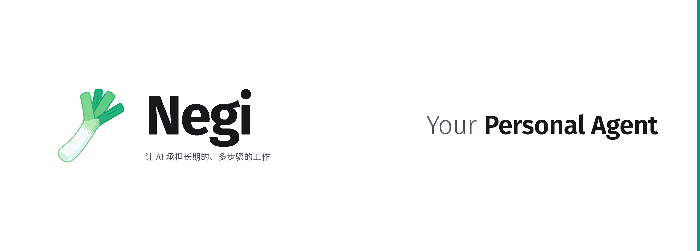
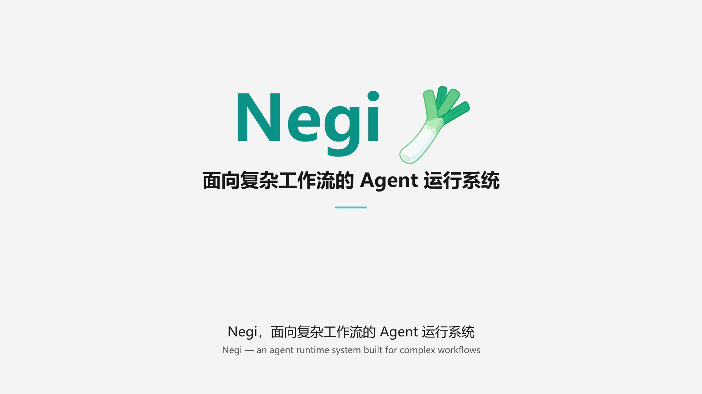

<p align="center">
  
</p>

# Negi

一个装在自己电脑上的 Agent。你给它起名字、定脾气、配上自己的表情包，然后把它接进 QQ。它记得你说过的话，能在后台替你跑很长时间的活，被拉进群也不会把你的私事讲出去。

[](https://github.com/user-attachments/assets/a6959a29-cd5e-41ef-ab7b-f28656bdc55f)

目录：[它能做什么](#它能做什么) · [安装](#安装) · [装完之后](#装完之后) · [群聊里的它](#群聊里的它) · [长任务](#长任务) · [你需要知道的事](#你需要知道的事) · [操作参考](#操作参考) · [深入阅读](#深入阅读)

## 它能做什么

### 它有自己的样子

装完第一件事是让它认识你，顺便认识它自己：写一段它是谁、什么脾气、怎么说话，再传几张照片。

想改不用回设置页翻表单，直接在对话里说就行，它自己会去改。

### 它会发表情包

图库是你的：上传、分类，每个分类写一句「什么时候用」——比如「被无理要求、被催活时用」。它按这句话挑分类，不看图里画了什么。

挑到具体某一张时，它会先把这个分类摊成一张带编号的拼图看一眼，再回一个编号，系统按编号取图、核对哈希，然后发出去。所以它能精确发出你想要的那一张，而不是在分类里瞎抽。看不了图的模型走分类内随机。

懒得自己攒图的话，AstrBot 社区的表情包可以直接装：说出你想要什么题材，它去社区索引里挑几个候选，把许可条款和是否经过审核一并报给你，你点头才落盘。

QQ 官方机器人和 OneBot 桥都按普通图片消息投递，每轮发几张可配，0 到 4。

### 你说话它听得懂

输入区的麦克风按钮一直在。语音转写在本机完成，用的是 whisper.cpp，音频不上传任何地方。QQ 那边收到的语音也一样在本机转，转写完还留着原始音频可以回放。

第一次点麦克风才会去下载程序和模型，合计约 157 MB。不想等就先跑 `negi stt prepare`。

### 它记得住

记忆分四层：常驻在每轮开头的索引、归并区、详情笔记、底层的 SQLite。重要的事由一个独立的记忆流程沉淀，进队列、审阅、批量应用，你能在「记忆」页面看到并干预。

压缩历史时记忆行永远不会被删掉，只是从常驻区搬到归并区，需要时随时读回来。

### 它能替你干长活

在对话里说清目标和验收标准，它会把活拆成一棵节点树，交给后台进程按回合推进，跨小时跨天都行。跑完了主动推送告诉你。

每个节点的结果可以有独立的验收环节，验收不通过会自动照着继续调整，不会糊弄过去。

### 它在哪都能用

浏览器里是一个完整的管理界面：会话、任务、技能、工具、记忆、模型、外部接入、日志，八个页面。QQ 里是一个机器人。别的程序可以按 OpenAI 协议调它，也可以通过 MCP 把它的工具接进自己的流程。

接模型支持 `OpenAI Chat` 和 `OpenAI Responses` 两种协议，保存时会先发一次真实的探测请求，字段不兼容当场就报出来，不会等你用的时候才发现。

## 安装

需要 Python 3.12 或更高。不用自己装，脚本会准备好。

### Windows

**推荐：双击安装包。** 发布页的 `Negi-Setup-<版本>.exe`，向导只问一个安装目录，剩下全自动。已经装过的机器再跑一次它就是升级。

安装包里带着该版本的源码快照和 uv：全新安装不为「取代码」访问 GitHub，也不下载 uv；Python 解释器和依赖仍要联网，直连失败会自动换镜像重试（见下节）。升级要取目标版本的代码，仍从 GitHub 走。

这个 exe 没有签名，首次运行 Windows 可能会拦一下，点「更多信息」→「仍要运行」。

**或者用一行命令：**

```powershell
iwr https://github.com/ZXY39/Negi/releases/latest/download/install.ps1 | iex
```

### Linux / macOS

```bash
curl -LsSf https://github.com/ZXY39/Negi/releases/latest/download/install.sh | bash
```

默认装到 `~/Negi`。脚本会自己装 uv、准备 Python、拉代码、按锁文件建环境，最后把服务起起来。

装完它会做三件事：把 `negi` 命令放进 `~/.local/bin`（不在 PATH 上就顺手加上）、在桌面和开始菜单各放一个图标、在系统「已安装的应用」里登记一条卸载项。三件都能用参数跳过，见[操作参考](#操作参考)。

### 网络慢或连不上 GitHub

Windows 用 `Negi-Setup-<版本>.exe` 时**一个文件就够，全程不访问网络**：它自带这个版本的源码、这台机器要的全部依赖 wheel、Python 解释器和 uv，安装时只做本机校验与环境拼装。用一行命令或仓库里的 `install.ps1` / `install.sh` 装则不同——脚本本身和依赖仓库外的解释器仍要联网：解释器从 python-build-standalone 下载、依赖从 PyPI 取，这两步直连失败会自动换镜像重试一次（清华 PyPI、SJTU 的 python-build-standalone 镜像）。想一开始就走镜像，把脚本下载下来加 `-Mirror` / `--mirror`（一行命令不能传参）；只想直连用 `-NoMirror` / `--no-mirror`；自己设了 `UV_DEFAULT_INDEX` / `UV_PYTHON_INSTALL_MIRROR` 就按你的来，脚本不覆盖。

连 PyPI 也去不了的设备（内网、完全离线）：Windows 下 `Negi-Setup-<版本>.exe` 一个文件就够，它自带源码、这台机器要的全部依赖 wheel、Python 解释器和 uv，装完不访问任何索引，也不需要 git。Linux / macOS 不发独立安装包——需要离线装时，用 PowerShell 7 在那台机器上跑一次 `packaging/build-offline-kit.ps1 -Platform <linux-x64|macos-arm64>` 生成套件，再 `install.sh --kit <文件>`；套件装之前先跟本机对账（平台、版本、每颗 wheel 的 sha256），对不上就拒绝安装，不会装出一半。这样装的设备之后靠换一份新套件更新，`git fetch` 那条道对它不适用。

一行命令那条通道没有内置载荷：脚本本身和代码都还从 GitHub 取。GitHub 连不上时优先用安装包；只取脚本这一步想走镜像，仓库地址和参数都不变：

```powershell
iwr https://cdn.jsdelivr.net/gh/ZXY39/Negi@latest/install.ps1 | iex
iwr https://ghfast.top/https://github.com/ZXY39/Negi/releases/latest/download/install.ps1 | iex
```

注意这两条只加速脚本本身：脚本跑起来后仍然直连 GitHub 拉代码。走第三方代理等于把「执行什么代码」交给了对方。稳妥的做法是先下载再看一眼：脚本首行应该是 `#requires -Version 5.1` 或 `#!/usr/bin/env bash`，里面的 `$Ref` / `REF` 就是它将要装的版本。jsdelivr 按标签缓存，发新版后 `@latest` 可能滞后，急用就把地址里的 `@latest` 换成 `@vX.Y.Z`。

## 装完之后

### 1. 设一个项目口令

首次启动会在浏览器里要求创建。这个口令用来派生主密钥，保护配置里的所有密钥，**丢了没法恢复**。

### 2. 配模型

「模型」页 → 添加模型 → 填名称、接口地址、密钥。然后点右上角进模型顺序编辑，把左侧已保存的模型拖进右侧对应角色，保存。

四个角色：主对话、执行、检验、记忆。只配主对话也能聊，但要用后台任务和长期记忆，四个都得配上。

每个角色可以配一组模型，**排列顺序就是接替顺序**：前一个限流或超时了，自动交给下一个。执行和检验两个角色还能把多个模型归成一组分摊请求量。

### 3. 填人设

在会话中告诉TA是谁、怎么说话，传几张照片。

### 4. 传表情包

「表情包」页建包、建分类、上传，然后给每个分类写一句「什么时候用」。这句话是它选图的唯一依据，写「什么时候用」，别写「图里有什么」。

想省事就在对话里说一句「从 AstrBot 社区找个 xxx 的表情包」，它会去索引里找候选、报许可、探测分类、落盘注册。

### 5. 接 QQ（可选）

去 QQ 开放平台申请一个机器人，拿到 AppID 和 AppSecret，填进「外部」页面的 QQ 官方机器人面板。走的是官方接口，不碰个人号协议。

支持多账号，一个账号一条独立的桥接身份和会话范围，互不影响。图片、文件、语音都能收发，心跳提醒和任务结束通知也能主动推。

接其他平台用独立的桥接程序，仓库里带一个 QQ / OneBot 11 的参考实现（`bridges/qq-onebot/`，比如 NapCat）。

### 启动和停止

装完之后有三种等价方式启动：任意目录敲 `negi`、点桌面图标、或者在安装目录跑一键启动脚本 `start-negi.ps1` / `start-negi.sh`（参数见[操作参考](#启动脚本参数)）。

- `negi` 会先探测服务在不在跑。在跑就只打开界面，不会重启正在干活的实例
- 点图标开的是**桌面窗口**，用系统自带的 WebView2 承载，不需要浏览器。关窗不停服务，再点一次就重开
- 服务不依附启动它的那个命令行窗口，**关掉窗口它继续跑**。实时日志在 `.g3ku/logs/console.log`
- 停止用网页「设置」里的「退出」按钮，它会先暂停正在跑的任务再关服务

默认端口 18790，浏览器访问 `http://127.0.0.1:18790`。

## 群聊里的它

把它拉进群，或者让陌生人加它私聊，是这套系统里最需要小心的一件事。Negi 的处理方式是按会话来源分三档信任：你自己的会话、陌生私聊、群聊。

**陌生人和群成员默认进受限模式。** 没装沙箱后端时以只读档运行：

- 能用的工具只剩十来个，全部无副作用
- 能读的只有本会话的上传文件和临时目录，`.g3ku/`、`memory/`、`sessions/` 和其他会话一律读不到
- 长期记忆不注入，写入请求直接拒
- **你的人设也不注入**——群里的人看到的是另一份「群聊人设」，不是你私聊里那个它
- 不能派任务、不能执行命令、不能写文件

装了沙箱后端并跑完验收之后，可以升到 `jailed` 档：数据面工具在 bwrap / WSL / seatbelt / 容器里执行，可写卷只有工作区，默认断网。这一步是可选的，只读档不需要任何额外安装。

你自己会话的权限不受影响。

工具与技能本身还有一层按角色的可见范围控制（主对话 / 执行 / 检验），在 Tool 和 Skill 页面编辑，清空某条目的全部角色就等于对它隐身。命令执行可以要求人工批准，批准结果分本次允许、加入白名单、拒绝三种。

## 长任务

### 节点之间会说话

任务拆成节点树，每个节点跑自己的回合。节点之间可以直接发消息：发给父节点、发给自己的后代、发给同父的兄弟，根节点还能把消息发回你正在聊的那个会话。派生只能自上而下。

节点可以停下来等。等的时候最好说清楚在等谁——说了，两个节点互相等就构成一个可证明的环，系统会打破它；被等的那个结束或被暂停时，等着的一方立刻收到一条带原因的消息。没说也有一层兜底：整个任务再没有节点在干活时，最浅的那个会被叫醒。等人不算，那是合法的无限等待。

### 结构由你定

引擎不预设编排结构。随仓库带一个编排 skill，给出五种结构的选型表和可以直接填的子节点提示词模板：并行取证后汇总、多角色辩论互评、分票统计、中途要人点头、分批流水。

skill 只规定怎么组织，不点名任何一颗工具。想搭自己的结构，照着格式写一份 skill 就行。

不在引擎里的：任意 DAG（跨分支只能经共同祖先转述）、自动计票与法定人数。

### 它不会跑一半就丢

正常退出时系统先在有限时间内排空正在执行的回合，再停服务。还停在暂停状态的任务，重启后会逐个判断这一轮此前有没有真的产生过影响（写过文件、发过消息），再决定继续、重做、还是交回模型判断。判断不了就按「已有影响」处理，宁可少做一次也不重复做。

同时跑多少回合不是固定的，由事件循环延迟、写入队列、内存余量、上游限流和磁盘空间实时决定。磁盘不够是唯一能把并发直接压到零的情况，其余因素只逐级收紧。

### 它不糊弄

历史内容只在一个位置收敛：一次对话快要超出模型窗口时，较早的历史被替换成摘要，你也可以手动触发。除此之外一律追加，所以请求的前缀是稳定的，上游的自动前缀缓存能持续命中。超长的工具结果不进历史，写进文件给个引用，模型需要时自己回读。

命中率是多少不用猜，回合气泡、节点详情、任务的 Token 统计里都直接显示。新会话第一轮、压缩之后、换模型之后会回落，这是机制决定的，不是出了问题。

## 你需要知道的事

- **QQ 主动消息有额度。** 受开放平台的额度和回复时间窗约束，**由网页发起的会话回复同样受限**。表现为网页上有完整回复，QQ 那边没收到。
- **新增 QQ 账号后旧会话标识不迁移。** 指向旧会话的定时任务和提醒目标要手动改指。
- **配置包默认只导出「配置」。** 记忆、人设、表情包要自己勾。导入是整面替换，导入后 worker 需要重启。任务、会话和日志不在包里。
- **表情包直接拷进目录不生效。** 目录只说明文件存在，注册表才决定可见，必须走注册。单个分类上限 36 张。
- **精确选图需要模型支持识图。** 在模型详情页勾「是否为图像多模态」，没勾就只能分类内随机。
- **首次点麦克风才下载语音组件**，约 157 MB。模型没准备好时语音退回普通文件处理，不会静默丢掉。
- **页面操作能力不是内置工具。** 由自带的 `web-access` 技能提供，需要你本机 Chrome 开远程调试并装 Node.js 22 或更高。好处是能沿用你已有的登录状态。
- **exe 未签名**，首次运行有 SmartScreen 提示。
- **以源码包方式安装的设备，升级不回收上一版被删掉的文件。** 需要完整一致的文件集合就用 git 安装，或者删目录重装。
- **升到 `jailed` 档要两步**：装好沙箱后端并跑完验收清单，再显式设 `G3KU_SANDBOX_ENABLE_JAIL=1`。默认不发放——后端没接进执行道时，安装态再好看也只给只读档。
- **性能历史只保留 24 小时**，而且只有 Agent 工具能读，任务页显示的是实时值。
- **磁盘低于阈值时并发直接收拢**，这是为了防止写出半完成的数据。

## 操作参考

### 升级

- **看有没有新版**：项目目录里跑 `negi status`，最后一行 `Release:` 显示当前版本和远端最新标签。离线、缺 git、或者远端不是本仓库时这行不出现——它不会给你一个错误的「已是最新」。
- **自动检查**：服务运行期间每 5 小时一次，启动时一次。开关和间隔在配置的 `update_check`。项目锁定时不检查也不提醒。
- **有新版时**：侧栏「设置」按钮左上角出现标记。点「重启并更新」，进度在页面内的提示条里按阶段走，不弹命令行窗口。代码不会被自动替换，必须你确认。
- **手动升级**：安装目录里执行 `.\install.ps1 -Upgrade -Dir .`（Linux / macOS `./install.sh --upgrade --dir .`）。`-Dir` 不能省，脚本按它决定动哪个目录，省略了就会去动默认的 `~/Negi`。
- **改过仓库自带文件时** `-Upgrade` 会拒绝执行，先提交或丢弃这些改动。自己装的技能、桥接产物不算。
- 完整过程写在 `.g3ku/logs/update-apply.log`，超过 30 秒没新输出会另记一行「仍在运行」，慢网络下能区分等待和卡死。

### 卸载

Windows 在「设置 → 应用 → 已安装的应用」里找到 Negi 点卸载，或者在安装目录执行 `.\uninstall.ps1`。Linux / macOS 执行 `./uninstall.sh`。

卸载先请求正在运行的服务优雅退出；等不到的进程（包括桌面窗口与 MCP 网关）按同一判据强制结束，只有结束不掉的才中止、一个文件都不删。然后决定数据怎么处置：

| 选择 | 结果 |
| --- | --- |
| 保留数据（默认） | 删掉程序本体、命令行入口、图标、卸载项；`.g3ku/` 里的配置、会话、任务、密钥留在原地，下次装回同一目录直接认领 |
| 全部删除 | 连数据目录一起删，无法恢复 |

从「设置」进入时这个问题由卸载向导问，选取消不会删任何东西；手跑 `uninstall.ps1` 不提问，按默认的保留数据执行，要连数据一起删显式带开关。Linux / macOS 在终端里问。

命令行参数：`-KeepData` / `--keep-data`、`-PurgeData` / `--purge-data` 指定数据去向，`-Yes` / `--yes` 按默认的保留数据执行。uv 和它代管的 Python 属共享工具链，卸载不碰。逐项结果写在 `%TEMP%` 里 `negi-uninstall-<时间>.log`，路径也在输出最后一行。

### 安装脚本参数

| 参数 | 作用 |
| --- | --- |
| `-Dir PATH` / `--dir PATH` | 指定安装目录 |
| `-NoStart` / `--no-start` | 只准备环境，不启动服务 |
| `-Ref TAG` / `--ref TAG` | 指定版本，用于回滚或试装 |
| `-Upgrade` / `--upgrade` | 更新已安装的设备到指定版本 |
| `-NoPath` / `--no-path` | 写命令桩但不改 PATH |
| `-NoShortcut` / `--no-shortcut` | 不创建桌面与开始菜单图标 |
| `-Mirror` / `--mirror` | Python 与依赖直接从内置镜像下载 |
| `-NoMirror` / `--no-mirror` | 只走直连，失败不自动换镜像 |
| `-Kit PATH` / `--kit PATH` | 从离线套件安装，全程不访问包索引 |

### 启动脚本参数

| Windows | Linux / macOS | 作用 |
| --- | --- | --- |
| `-BindHost` | `--host` | 监听地址 |
| `-Port` | `--port` | 端口 |
| `-OpenBrowser` | `--open-browser` | 启动后打开浏览器 |
| `-PromptLog` | `--prompt-log` | 记录提示词日志 |
| `-Reload` | `--reload` | 开发用自动重载 |
| `-KeepWorker` | `--keep-worker` | 退出时保留托管的执行进程 |

### 命令一览

```bash
negi                                    # 没在跑就启动并打开界面，已在跑就只打开界面
negi window                             # 打开桌面窗口（服务需已在跑，Windows 专属）
negi web                                # 前台启动 Web 服务（默认托管任务执行进程）
negi web --host 127.0.0.1 --port 18790
negi web --reload                       # 开发用自动重载（此时不再托管执行进程）
negi worker                             # 单独启动后台任务执行进程
negi agent -m "你好，介绍一下你自己"     # 命令行对话，单条消息测试
negi status                             # 运行状态与版本信息
```

其余命令：`negi onboard`（生成配置与工作目录）、`negi cron`（定时任务）、`negi memory`（记忆维护）、`negi resource`（资源检查与重载）、`negi provider`（模型提供方）、`negi external`（对外接口只读诊断）、`negi stt`（语音识别准备）、`negi mcp serve` / `negi mcp check`（工具网关与自检）。都支持 `--help`。

排查启动链路时用 `negi web` 前台跑，实时输出在眼前、Ctrl+C 能停。`negi` 起的服务是脱离式子进程，关终端不影响它。

### 手动准备环境

面向需要完全控制环境的人：

```bash
git clone <仓库地址>
cd Negi
uv sync --frozen --extra dev        # 或 pip install -e ".[dev]"
negi onboard --project              # 生成 .g3ku/config.json
```

命令桩按 `G3KU_HOME` → 安装根指针文件的顺序找安装目录。手动准备环境时把 `G3KU_HOME` 指到仓库根，或者直接执行 `./negi.sh`。

### Docker 部署

长期运行的服务部署用仓库内置的 Compose。先复制 `.env.docker.example` 为 `.env`，按需改里面的值，然后在仓库根目录执行：

```bash
docker compose up --build
```

`.env` 是给 compose 运行时做变量插值用的，镜像里不需要它，`.dockerignore` 已经把它排除在构建上下文之外。

镜像基于 `python:3.12-slim`，用 `uv sync --frozen --no-dev` 装依赖。`web` 负责界面、接口、心跳、定时任务和对外接入，`worker` 只负责后台任务执行，分开是为了让界面入口和任务执行互不影响。

`G3KU_BOOTSTRAP_PASSWORD` 用于容器启动时自动解锁**已经初始化过**的项目（另有 `G3KU_BOOTSTRAP_MASTER_KEY`）。首次安装仍然要在浏览器里创建口令，这个变量不代劳。示例值 `change-me` 会以明文出现在容器环境里，共享主机上部署前换掉。

**这些目录必须挂持久卷**，否则容器重启后状态会丢：

```
.g3ku/  memory/  sessions/  temp/  skills/  tools/  externaltools/
```

只挂一部分通常不够——系统照样能起来，但重启后丢状态。如果 Web 正常而任务状态在 worker 重启后没了，先核对挂载，再怀疑业务逻辑。

容器里缺少宿主设备和浏览器，所以麦克风和本机浏览器页面操作这两项仍按本机方式使用。

### 对外接口

三种形式，都随 `externalApi.enabled` 一并开启：

- **桥接接口** `/api/v1`：平台无关，桥接程序作为独立进程运行，把平台消息提交为会话回合、订阅流式事件、再把回复发回去。每个桥接用独立的标识和凭证，会话范围彼此隔离。凭证以明文提交保存时会自动移入加密存储，配置文件里只留占位。
- **OpenAI 兼容接口** `POST /api/v1/chat/completions`：任何按 OpenAI 协议调用的客户端都能用。
- **工具网关** `negi mcp serve`：把系统能力以标准工具协议暴露给本机其他程序。

判定原则：**换一个聊天平台就需要改的代码，不放在核心内**。平台协议、消息分段、频率限制、触发词识别一律属于桥接层。QQ 官方适配器（`g3ku/qq_official/`）是唯一内置的例外，QQ 协议只出现在那个模块里。

## 深入阅读

架构文档在 [`docs/architecture/`](docs/architecture/README.md)，入口文件有完整的阅读顺序、主题索引和排障入口。想搞清楚某个子系统怎么运作，从那里进。

几处常用的：

| 想了解 | 看 |
| --- | --- |
| 会话生命周期、模型路由、工具执行流程 | `runtime-overview.md` |
| 节点信箱、验收裁决、暂停恢复、退出与重启 | `main-task-runtime.md` |
| 缓存未命中、历史收敛、请求内容取证 | `context-and-cache-troubleshooting.md` |
| 信任分级、只读档、工具白名单、读根边界 | `sandbox-execution-plane.md` |
| 工具与技能的可见范围、按需加载、权限治理 | `tool-and-skill-system.md`、`tool-hydration-and-callable-chain.md` |
| 界面与后端的职责边界、消息通道约定 | `web-and-admin.md` |
| 配置来源、角色到模型的解析 | `config-and-models.md` |
| 对外接口鉴权、会话登记、事件映射 | `external-agent-api.md`、`agent-gateway.md` |
| 语音转写的引擎、音频规格、精度权衡 | `speech-to-text.md` |
| 启动流程、排障顺序、容器部署 | `operations-and-maintenance.md` |

想改代码的话，先读仓库根的 [`AGENTS.md`](AGENTS.md)。提交前跑：

```bash
python -m ruff check .
python -m pytest tests/resources/test_resource_runtime_smoke.py -q
```

全量 `pytest` 有少量历史失败用例，不要把「全量通过」当前置条件。

## 致谢

Negi 早期在设计与迭代过程中参考了若干开源项目的工程实践与产品思路，在此致谢：

- [OpenClaw](https://github.com/openclaw/openclaw)：项目整体方向与 Agent 工程化实践。
- [Hermes Agent](https://github.com/NousResearch/hermes-agent)：自主维护记忆与长期协作能力。
- [oh-my-openagent](https://github.com/code-yeongyu/oh-my-openagent)：多 Agent 编排与任务拆解。
- [OpenViking](https://github.com/volcengine/OpenViking)：分层按需加载、能力暴露控制与上下文组织。
- 以及其他参考过的项目。

Negi 是结合自身目标、运行设计和使用场景的独立项目。`skills/web-access`、`bridges/qq-onebot` 等随仓库提供的第三方内容各自保留其原始许可声明。

## 许可证

MIT，详见 [LICENSE](LICENSE)。
